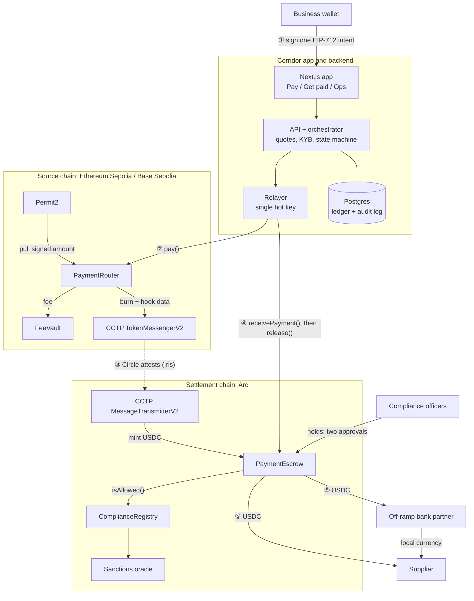
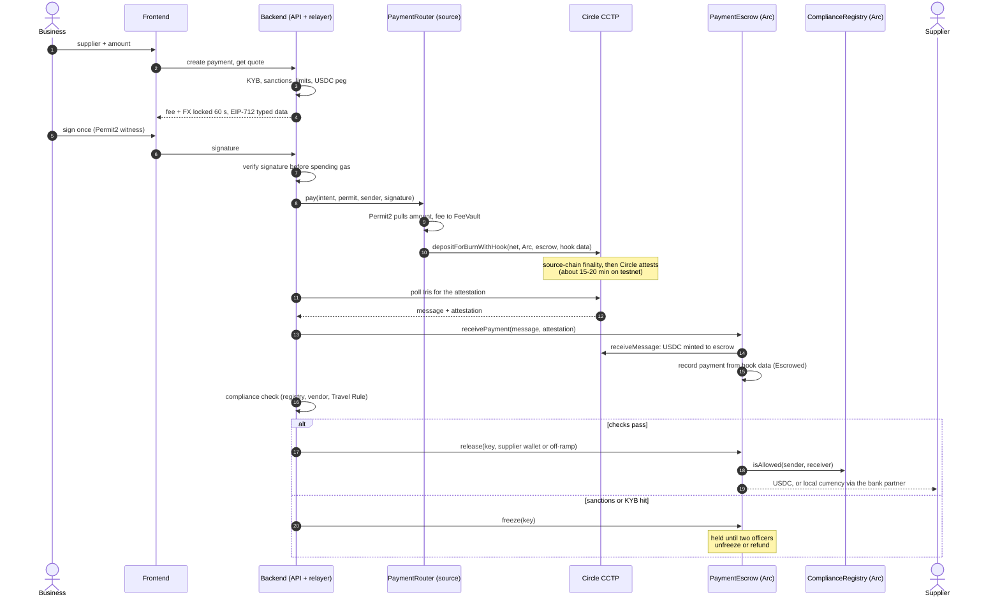
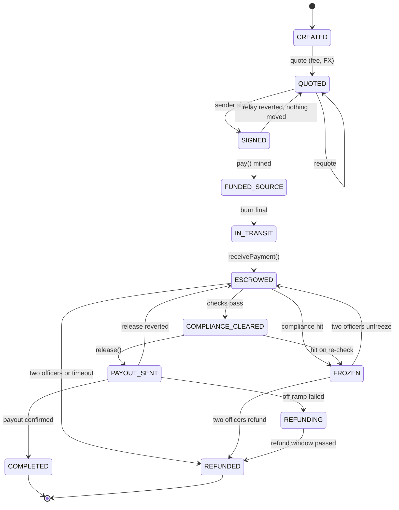
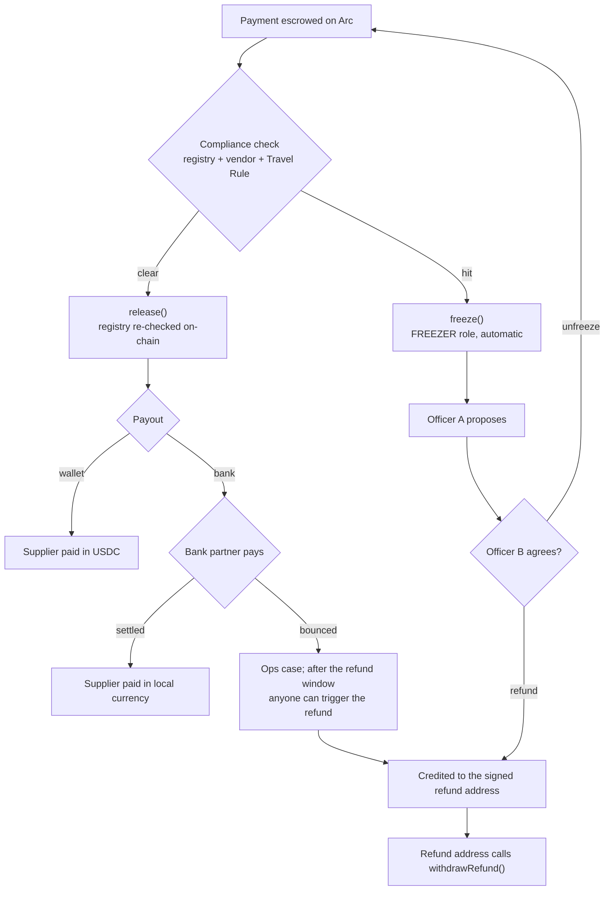

<div align="center">

# Corridor

**Cross-border B2B payouts on stablecoins: one signature in, compliance before any value moves, paid out or refunded exactly once.**

USDC in on an EVM chain → across chains with Circle CCTP → held in escrow on Arc → paid out as USDC or local currency.


</div>

---

## Contents

- [Why](#why)
- [What it does](#what-it-does)
- [Architecture](#architecture)
- [How a payment flows](#how-a-payment-flows)
- [Payment state machine](#payment-state-machine)
- [Compliance and failure handling](#compliance-and-failure-handling)
- [Smart contracts](#smart-contracts)
- [Backend](#backend)
- [Frontend](#frontend)
- [Repository layout](#repository-layout)
- [Run it locally](#run-it-locally)
- [Deploy to testnet](#deploy-to-testnet)
- [Live testnet deployment](#live-testnet-deployment)
- [Testing](#testing)
- [Security](#security)
- [Roadmap](#roadmap)

## Why

A business paying a supplier abroad today waits days for a correspondent-bank wire and pays for every hop. Card
networks already settle between banks in regulated stablecoins. Visa passed a $20B annualized stablecoin settlement run rate
in 2026, and Mastercard settles in six stablecoins across eight chains. **Corridor is the layer above that:** each B2B
payment is checked, moved across chains, and paid out, with the guarantees a payments team needs:

- **One signature** from the sender. No gas, no bridge UI, no token approvals per payment.
- **Compliance before value moves**: KYB, sanctions screening, and Travel Rule data are checked before the payout. A
  payment that fails a check stays in escrow; it is never released to the wrong party.
- **Exactly-once outcome**: every payment ends *paid out* or *refunded*, never stuck halfway, never paid twice.
- **Auditable**: a double-entry ledger reconciled against the chain, signed webhooks, and ISO 20022 `pacs.008` messages.

## What it does

| | |
| --- | --- |
| **Sender (business)** | Verifies once, approves USDC once, then pays any supplier with a single EIP-712 signature. The quote locks the fee and FX for 60 seconds. |
| **Supplier** | Verifies once, chooses USDC to a wallet or local currency to a bank account, and follows incoming payments with a receipt and ISO 20022 message. |
| **Ops** | Compliance queue with two-officer release or refund, ops cases, daily reconciliation and settlement reports, relayer health and fee balances. |
| **Net settlement** | Up to 50 supplier payments in one signature and one cross-chain transfer. |

## Architecture



**Key design choices**

- **The escrow is both the CCTP mint recipient and the only allowed destination caller.** A burn can only be delivered
  through `PaymentEscrow.receivePayment`, which records the payments from the router's hook data in the same call. No
  one can mint "around" the escrow, and the relayer never decides who a payment belongs to.
- **Every field that matters is signed by the sender.** The Permit2 witness covers the payment ID, receiver, refund
  address, fee, destination domain, and Travel Rule hash. A compromised relayer can delay a payment but cannot redirect it.
- **The chain is the settlement record; Postgres is the business record.** Every orchestrator step reads chain state
  first, so restarts and duplicate jobs are safe, and reconciliation proves the two agree.
- **Stateless source contracts, upgradeable settlement contracts.** The router and fee vault are immutable, with the
  same address on every chain through CREATE2. The escrow and registry are UUPS proxies behind an admin intended for a
  timelock or multisig.

## How a payment flows



**Money in a $10 payment** (standard tier: 30 bps fee, $0.50 minimum):

| Step | Chain | Amount |
| --- | --- | --- |
| Sender signs and the router pulls | Source | 10.50 USDC |
| Fee to `FeeVault` | Source | 0.50 USDC |
| Burned through CCTP (standard finality, no CCTP fee) | Source | 10.00 USDC |
| Minted into `PaymentEscrow` | Arc | 10.00 USDC |
| Released to the supplier (or the off-ramp, which pays local currency) | Arc | 10.00 USDC |

## Payment state machine

Each transition is one database transaction: a compare-and-set on the state, an audit-log line, a balanced ledger
entry, and signed webhooks. The diagram shows the main moves. The complete table is in
[`packages/shared/src/states.ts`](packages/shared/src/states.ts), and anything not in it is refused.



## Compliance and failure handling



| Risk | Detection | Response |
| --- | --- | --- |
| Stablecoin depeg | USDC/USD more than 0.5% off peg | Quoting pauses; routers can be paused |
| CCTP attestation outage | No attestation after 30 min | Payment shows "In transit", ops case opened; messages stay deliverable and are never double-minted |
| Off-ramp failure | Payout status `failed` | Ops case; refund after the escrow window; `setOffRamp(false)` |
| Relayer key compromise | Unexpected relayer transactions | Revoke `RELAYER`; every field is signed or comes from the burn, so funds cannot be redirected |
| FX drift | Quote vs execution | Quotes expire in 60 s; requote |
| False-positive sanctions hit | Ops review | Two officers unfreeze; payout resumes with a fresh window |

## Smart contracts

Solidity 0.8.37, OpenZeppelin 5.3, Foundry. Source in [`contracts/src`](contracts/src).

| Contract | Chain | Role |
| --- | --- | --- |
| [`PaymentRouter`](contracts/src/PaymentRouter.sol) | Source | `pay` / `payBatch`: Permit2 witness pull, fee to vault, `depositForBurnWithHook` into the escrow. Immutable, stateless, pausable. |
| [`FeeVault`](contracts/src/FeeVault.sol) | Source | Holds fees; only `TREASURY` withdraws. |
| [`PaymentEscrow`](contracts/src/PaymentEscrow.sol) | Arc | Receives CCTP messages and records payments; `release`, `freeze`, two-officer `unfreeze` / `refund`, timeout refunds, pull-based `withdrawRefund`. UUPS. |
| [`ComplianceRegistry`](contracts/src/ComplianceRegistry.sol) | Arc | KYB attestations with expiry plus a sanctions oracle; `isAllowed(from, to)` fails closed. UUPS. |
| [`SanctionsOracle`](contracts/src/SanctionsOracle.sol) | Arc (testnet) | Stand-in with the Chainalysis oracle's interface. |
| [`PQAccount`](contracts/src/PQAccount.sol) | Any | Post-quantum smart account: hash-based one-time signatures (Winternitz, keccak256) under a Merkle tree. `execute` lets it hold any role above; ERC-1271 lets a sender pay through Permit2 with it. |

**Roles**

| Role | Contract | Held by | Can |
| --- | --- | --- | --- |
| `RELAYER` | Router, Escrow | Backend hot key | Submit `pay` / `payBatch`, deliver `receivePayment` |
| `PAYOUT_OPERATOR` | Escrow | Backend | `release` to the receiver or an approved off-ramp |
| `FREEZER` | Escrow | Backend | `freeze` only (automatic hold) |
| `COMPLIANCE_OFFICER` | Escrow, Registry | Two or more people; the backend on the registry | Two-approver unfreeze and refund; write KYB attestations |
| `TREASURY` | FeeVault | Finance | Withdraw fees |
| `PAUSER` | Router, FeeVault | Ops | Pause |
| `DEFAULT_ADMIN_ROLE` | All | Timelock / multisig | Roles, trusted routers, off-ramps, upgrades |

The full design review, findings, and Slither / Aderyn triage are in [`contracts/AUDIT.md`](contracts/AUDIT.md).

## Backend

Node.js 24, Fastify, Drizzle ORM, viem. Postgres + Redis in production; embedded Postgres (PGlite) and an in-process
queue when they are not configured, so the whole stack runs with no Docker.

| Service | Where | Notes |
| --- | --- | --- |
| Quote | [`services/quote.ts`](backend/src/services/quote.ts) | Fee by tier (30 / 15 bps, $0.50 min), FX locked 60 s, HMAC-signed quote, per-payment and daily limits, peg check |
| Relayer | [`chain/viemGateway.ts`](backend/src/chain/viemGateway.ts) | One nonce manager; contract errors decoded for ops |
| Attestation poller | [`services/orchestrator.ts`](backend/src/services/orchestrator.ts) | Circle Iris `/v2/messages` with backoff; ops case after 30 min |
| Orchestrator | [`services/orchestrator.ts`](backend/src/services/orchestrator.ts) | One step per state; idempotent; BullMQ or in-process |
| Indexer | [`services/indexer.ts`](backend/src/services/indexer.ts) | Router and escrow events past confirmation depth, stored once |
| Ledger | [`ledger.ts`](backend/src/ledger.ts) | Double-entry journal; every entry sums to zero |
| Compliance | [`services/vendor.ts`](backend/src/services/vendor.ts) | KYB vendor sandbox → on-chain attestation; Travel Rule payload AES-256-GCM at rest, its hash signed in the intent |
| Payouts | [`services/payout.ts`](backend/src/services/payout.ts) | Wallet release and a mock bank (`FAIL…` accounts bounce) |
| Reconciliation | [`services/reconciliation.ts`](backend/src/services/reconciliation.ts) | Ledger vs escrow per payment; daily settlement CSV per corridor |
| Webhooks | [`services/webhooks.ts`](backend/src/services/webhooks.ts) | HMAC-signed, retried, deduplicated |
| ISO 20022 | [`services/iso20022.ts`](backend/src/services/iso20022.ts) | `pacs.008.001.08` per payment |

## Frontend

Next.js 16, Tailwind 4, wagmi + viem, optional Reown AppKit (WalletConnect).

- **Pay**: three guided steps (verify, allow USDC once, pay), suppliers added inline, a review screen with a live
  quote countdown, and a four-step progress bar (Signed → Sent → Checked → Paid) with the full timeline under
  "Technical details".
- **Get paid**: verification, payout method (wallet or bank), incoming payments, ISO 20022 download.
- **Ops**: compliance queue (officers approve from their own wallets), cases, reconciliation, health.

On the local chain the app offers Anvil's unlocked accounts as demo wallets, so the full demo runs without a browser wallet.

## Repository layout

```
.
├── contracts/            Foundry project: src, tests (unit, fuzz, invariant, fork), deploy scripts, AUDIT.md
│   ├── script/           DeployLocal.s.sol (Anvil), Deploy.s.sol (testnet), flatten-remix.sh
│   └── remix/            One self-contained file per contract for Remix
├── backend/              Fastify API, orchestrator, relayer, indexer, ledger, e2e script
├── frontend/             Next.js app: Pay, Get paid, Ops
├── packages/shared/      ABIs (generated from the Foundry build), EIP-712 builders, states, API types
├── scripts/              ABI generation, testnet key/funding/env helper, deploy script
└── docker-compose.yml    Postgres, Redis, Anvil, local deploy
```

## Run it locally

Needs Node 24+ and [Foundry](https://getfoundry.sh). Docker is optional.

```bash
git clone --recursive https://github.com/ketan-sol/stablecoin-payment-corridor.git
cd stablecoin-payment-corridor
npm install
cd contracts && forge build && cd ..
```

Contract dependencies (forge-std, OpenZeppelin 5.3, Permit2) are git submodules in `contracts/lib`. If you cloned
without `--recursive`, run `git submodule update --init --recursive`.

Then, in three terminals:

```bash
anvil
```

```bash
cd contracts && forge script script/DeployLocal.s.sol --rpc-url http://127.0.0.1:8545 --broadcast && cd ..
npm run dev:backend
```

```bash
npm run dev:frontend
```

Open http://localhost:3001 and connect **Demo sender (#2)**. Use **Demo supplier (#3)** on Get paid and the ops
token `dev-ops-token`. One Anvil chain plays both the source chain and Arc, with a local CCTP stand-in.

The scripted end-to-end demo (payment, batch, sanctions freeze with a two-officer refund, off-ramp failure with a timeout
refund, reconciliation) runs against the real contracts:

```bash
npm run e2e -w backend
```

With Docker, `docker compose up -d` starts Postgres, Redis, and Anvil and deploys the contracts. Then set
`DATABASE_URL` and `REDIS_URL` in `backend/.env` (see [`backend/.env.example`](backend/.env.example)).

## Deploy to testnet

Two paths:

**Scripted (Base Sepolia → Arc):**

```bash
node scripts/testnet.mjs keys
```

That writes throwaway testnet keys to `contracts/.env` (gitignored) and prints the addresses. Fund the deployer with
Arc USDC from [faucet.circle.com](https://faucet.circle.com) and some Base Sepolia ETH, then run:

```bash
scripts/deploy-testnet.sh
```

The script funds the relayer, deploys `settlement()` on Arc, then `source()` on Base Sepolia (CREATE2), then
`trustRouter()`, and writes `backend/.env` and `frontend/.env.local`.

**Remix:** use the flattened files in [`contracts/remix`](contracts/remix), deploying the escrow and registry with
"Deploy with Proxy". Set `SOURCE_CHAINS` and the per-chain `SEPOLIA_ROUTER` / `SEPOLIA_FEE_VAULT` (or `BASE_SEPOLIA_…`)
in `backend/.env`. Each source chain's router must be trusted on the escrow with `setRouter(domain, router, true)`.

CCTP domains: Ethereum `0`, Base `6`, Arc `26`. Testnet CCTP V2 contracts are the same on every chain
(`TokenMessengerV2 0x8FE6…2DAA`, `MessageTransmitterV2 0xE737…E275`). Arc's USDC is `0x3600…0000` (6 decimals through
the ERC-20 interface).

Then:

```bash
npm start -w backend
```

```bash
npm run dev:frontend
```

## Live testnet deployment

Ethereum Sepolia → Arc testnet, deployed 2026-10-22.

| Contract | Chain | Address |
| --- | --- | --- |
| PaymentRouter | Ethereum Sepolia | [`0x09a84EDb5F496083C24BaBb4F356e43A281b6bB0`](https://sepolia.etherscan.io/address/0x09a84EDb5F496083C24BaBb4F356e43A281b6bB0) |
| FeeVault | Ethereum Sepolia | [`0x8a549dEdA5C5EE255Cb3003657d9b0a26EE2aF82`](https://sepolia.etherscan.io/address/0x8a549dEdA5C5EE255Cb3003657d9b0a26EE2aF82) |
| PaymentEscrow (proxy) | Arc testnet | [`0x9A6016CD74De596D4A005358f17EDA56eDE03e03`](https://explorer.testnet.arc.io/address/0x9A6016CD74De596D4A005358f17EDA56eDE03e03) |
| ComplianceRegistry (proxy) | Arc testnet | [`0xE00A252C6F522179F889dFC5Ac0a34918EDd12D3`](https://explorer.testnet.arc.io/address/0xE00A252C6F522179F889dFC5Ac0a34918EDd12D3) |

The first payment (10 USDC Sepolia → Arc) started with the burn in
[`0x60e9a10a…c522`](https://sepolia.etherscan.io/tx/0x60e9a10a78dd191aaf489573c7795a7efa9649f66cef1146d81e5852772cc522).
Circle attested it, it was delivered into the escrow, and it was released to the receiver.

## Testing

| Suite | Command | What it covers |
| --- | --- | --- |
| Contracts | `cd contracts && forge test` | 58 unit, fuzz, and invariant tests: Permit2 witness, hook-data decoding, trusted routers, two-officer flow, pull refunds, pause, upgrades |
| Fork | `ARC_RPC_URL=… BASE_SEPOLIA_RPC_URL=… forge test --match-path 'test/fork/*'` | Real CCTP V2 contracts on testnet forks |
| Backend | `npm test` | 38 tests on embedded Postgres with a fake chain: every state path, chaos cases (relayer crash, delayed attestation, duplicate jobs), reconciliation, webhooks, pacs.008, API, config |
| End to end | `npm run e2e -w backend` | The four demo scenarios against real contracts on Anvil |
| Types | `npm run typecheck` | Shared package, backend, frontend |

`backend/test/unit.test.ts` and `contracts/test/TypedDataVector.t.sol` pin the same EIP-712 digest, so the signature
the frontend asks for is the one the contracts verify.

## Security

- **Self-reviewed, not externally audited.** See [`contracts/AUDIT.md`](contracts/AUDIT.md) for the threat model,
  findings, and tool triage. Do not use with real funds.
- **Testnet keys stay local.** `contracts/.env`, `backend/.env`, and `frontend/.env.local` are gitignored. The relayer
  key is a hot key with narrow roles; admin roles belong behind a timelock or multisig (`Deploy.s.sol --sig "timelock()"`).
- **Signed intents.** The sender's signature covers every field that decides where money goes. The relayer only pays gas.
- **Post-quantum option.** Any role, and any sender, can be a [`PQAccount`](contracts/src/PQAccount.sol), whose key is
  hash-based instead of ECDSA. The backend accepts ERC-1271 sender signatures. Each leaf signs once; the signer keeps state.
- **Fail closed.** If the sanctions oracle call reverts, `isAllowed` reverts, and payouts stop.
- **No stuck funds.** Undeliverable or unattributable CCTP messages are recorded as `Unattributed` and can be swept
  by the admin. Every escrowed payment has a refund path that anyone can trigger after the window.

## Roadmap

- [x] Contracts with unit, fuzz, invariant, and fork tests, plus a self-audit
- [x] Backend: quotes, relayer, orchestrator, ledger, compliance, payouts, reconciliation, webhooks, ISO 20022
- [x] Frontend: Pay, Get paid, Ops
- [x] Testnet: Ethereum Sepolia → Arc, first payment settled
- [ ] Post-quantum hardening: PQ smart-wallet senders and `PQAccount` role holders (done); source-burn check and
  release caps, backend PQ signer, officer signing tool, hybrid ML-KEM for Travel Rule data
- [ ] CI (contracts, backend, typecheck, build)
- [ ] Observability (metrics and alerts for attestation delay, relayer balance, reconciliation)
- [ ] A real off-ramp sandbox alongside the mock bank
- [ ] Base Sepolia router on the same escrow
- [ ] External audit before any mainnet use

## License

[MIT](LICENSE)
